

[English](README.md) · [Русский](README.ru.md) · [中文](README.zh.md) · [日本語](README.ja.md) · [한국어](README.ko.md) · [Português](README.pt.md) · **Español** · [Français](README.fr.md)

<a href="https://timoncool.github.io/YuE2-Studio/stats.html">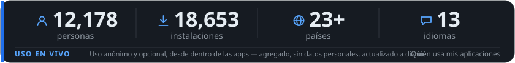</a>

**[Ver las estadísticas de uso en vivo →](https://timoncool.github.io/YuE2-Studio/stats.html)**

### Apps destacadas

<a href="https://github.com/timoncool/YuE2-Studio">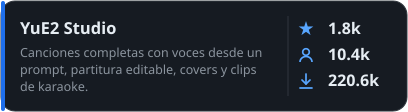</a> 

<a href="https://github.com/timoncool/dub-studio">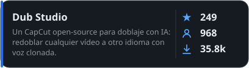</a> <a href="https://github.com/timoncool/MiniMax-Music3-Studio">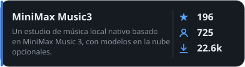</a>

<a href="https://github.com/timoncool/speech-studio">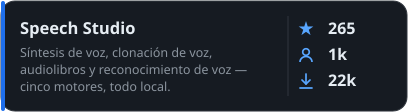</a> <a href="https://github.com/timoncool/Bulka">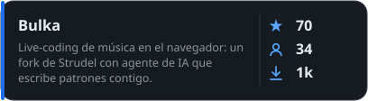</a>

<a href="https://github.com/timoncool/dungeon-ultimate">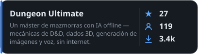</a>

### El trabajo


### Otros proyectos

####  Video & Vision

<a href="https://github.com/timoncool/videosos">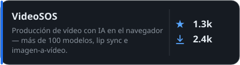</a> <a href="https://github.com/timoncool/SuperCaption_Qwen3-VL">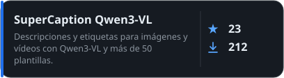</a>

####  MCP Servers

<a href="https://github.com/timoncool/telegram-api-mcp">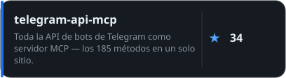</a> <a href="https://github.com/timoncool/civitai-mcp-ultimate">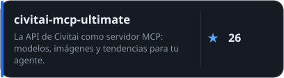</a>

<a href="https://github.com/timoncool/trail-spec">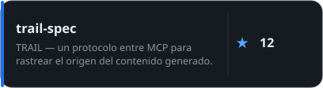</a> <a href="https://github.com/timoncool/hota-mcp">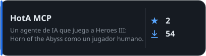</a>

####  AI Agents & Claude Code

 <a href="https://github.com/timoncool/prompt-warrior">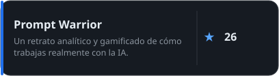</a>

<a href="https://github.com/timoncool/satori">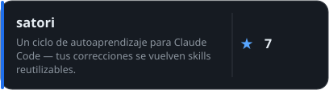</a> 

<a href="https://github.com/timoncool/angry-switcher">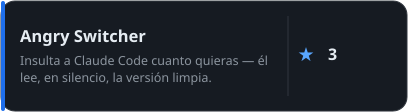</a> <a href="https://github.com/timoncool/slapbox">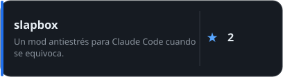</a>

<a href="https://github.com/timoncool/jarvis-codex-bot">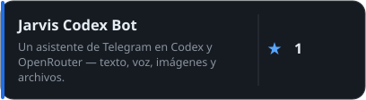</a>

####  Tools & Fun

<a href="https://github.com/timoncool/godot-strudel">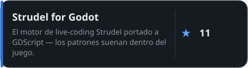</a> <a href="https://github.com/timoncool/hermes-ru-locale">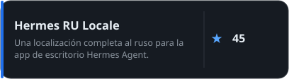</a>

<a href="https://github.com/timoncool/gitlife">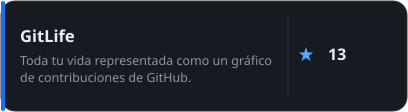</a> <a href="https://github.com/timoncool/tg-challenge-bot">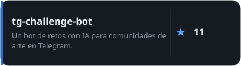</a>

<a href="https://github.com/timoncool/pip-twin">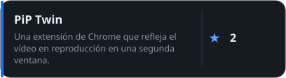</a>

### Apoya mi trabajo

Creo apps de IA gratuitas, open-source y local-first para todos. Tu apoyo las mantiene vivas =)

**BTC:** `1E7dHL22RpyhJGVpcvKdbyZgksSYkYeEBC` · **ETH:** `0xb5db65adf478983186d4897ba92fe2c25c594a0c` · **USDT:** `TQST9Lp2TjK6FiVkn4fwfGUee7NmkxEE7C`

Actualizado: 2026-11-04 · Los números de uso se actualizan a diario desde estadísticas anónimas.

