

[English](README.md) · [Русский](README.ru.md) · [中文](README.zh.md) · [日本語](README.ja.md) · [한국어](README.ko.md) · [Português](README.pt.md) · [Español](README.es.md) · **Français**

<a href="https://timoncool.github.io/YuE2-Studio/stats.html">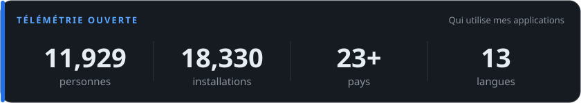</a>

**[Voir les statistiques d’usage en direct →](https://timoncool.github.io/YuE2-Studio/stats.html)**

Usage anonyme et volontaire, depuis les applis — agrégé, sans données personnelles, mis à jour chaque jour.

### Applis en vedette

<table>
  <tr>
    <td width="416" valign="top"><a href="https://github.com/timoncool/YuE2-Studio">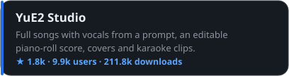</a></td>
    <td width="416" valign="top"><a href="https://github.com/timoncool/ACE-Step-Studio">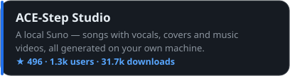</a></td>
  </tr>
  <tr>
    <td width="416" valign="top"><a href="https://github.com/timoncool/dub-studio">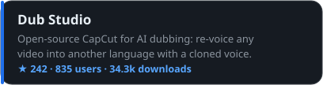</a></td>
    <td width="416" valign="top"><a href="https://github.com/timoncool/MiniMax-Music3-Studio">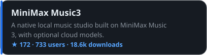</a></td>
  </tr>
  <tr>
    <td width="416" valign="top"><a href="https://github.com/timoncool/speech-studio">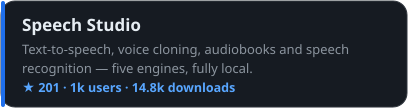</a></td>
    <td width="416" valign="top"><a href="https://github.com/timoncool/Bulka">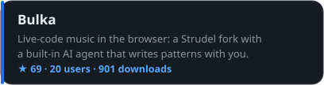</a></td>
  </tr>
  <tr>
    <td width="416" valign="top"><a href="https://github.com/timoncool/dungeon-ultimate">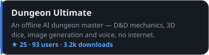</a></td>
    <td></td>
  </tr>
</table>

### Le travail


Activité publique via l’API GitHub — mise à jour chaque jour.

### Autres projets

#### 🎬 Video & Vision

<table>
  <tr>
    <td width="416" valign="top"><a href="https://github.com/timoncool/videosos">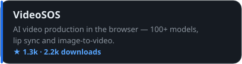</a></td>
    <td width="416" valign="top"><a href="https://github.com/timoncool/SuperCaption_Qwen3-VL">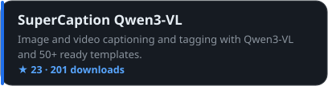</a></td>
  </tr>
</table>

#### 🔌 MCP Servers

<table>
  <tr>
    <td width="416" valign="top"><a href="https://github.com/timoncool/telegram-api-mcp">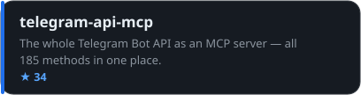</a></td>
    <td width="416" valign="top"><a href="https://github.com/timoncool/civitai-mcp-ultimate">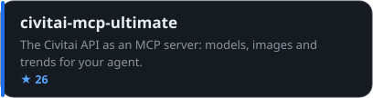</a></td>
  </tr>
  <tr>
    <td width="416" valign="top"><a href="https://github.com/timoncool/trail-spec">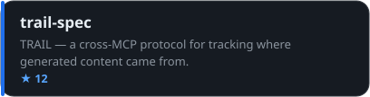</a></td>
    <td width="416" valign="top"><a href="https://github.com/timoncool/hota-mcp">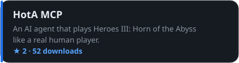</a></td>
  </tr>
</table>

#### 🧠 AI Agents & Claude Code

<table>
  <tr>
    <td width="416" valign="top"><a href="https://github.com/timoncool/givememod">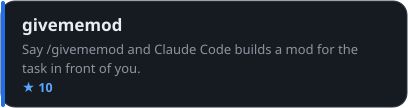</a></td>
    <td width="416" valign="top"><a href="https://github.com/timoncool/prompt-warrior">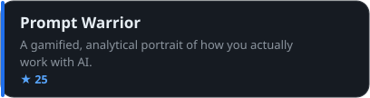</a></td>
  </tr>
  <tr>
    <td width="416" valign="top"><a href="https://github.com/timoncool/satori">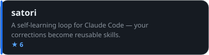</a></td>
    <td width="416" valign="top"><a href="https://github.com/timoncool/dream-skill">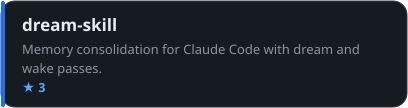</a></td>
  </tr>
  <tr>
    <td width="416" valign="top"><a href="https://github.com/timoncool/angry-switcher">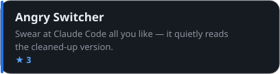</a></td>
    <td width="416" valign="top"><a href="https://github.com/timoncool/slapbox">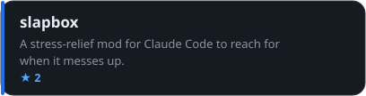</a></td>
  </tr>
  <tr>
    <td width="416" valign="top"><a href="https://github.com/timoncool/jarvis-codex-bot">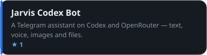</a></td>
    <td></td>
  </tr>
</table>

#### 🧰 Tools & Fun

<table>
  <tr>
    <td width="416" valign="top"><a href="https://github.com/timoncool/godot-strudel">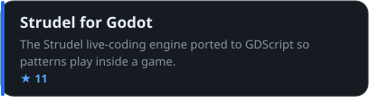</a></td>
    <td width="416" valign="top"><a href="https://github.com/timoncool/hermes-ru-locale">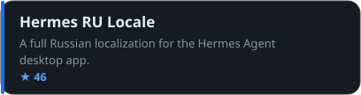</a></td>
  </tr>
  <tr>
    <td width="416" valign="top"><a href="https://github.com/timoncool/gitlife">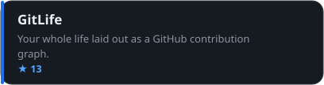</a></td>
    <td width="416" valign="top"><a href="https://github.com/timoncool/tg-challenge-bot">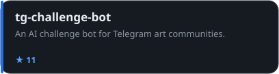</a></td>
  </tr>
  <tr>
    <td width="416" valign="top"><a href="https://github.com/timoncool/pip-twin">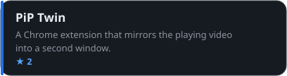</a></td>
    <td></td>
  </tr>
</table>

### Stack technique

<h4>Stack technique</h4>

     

   

     

### Soutenir mon travail

Je crée des applis IA gratuites, open-source et local-first pour tous. Votre soutien les fait vivre =)

**BTC:** `1E7dHL22RpyhJGVpcvKdbyZgksSYkYeEBC` · **ETH:** `0xb5db65adf478983186d4897ba92fe2c25c594a0c` · **USDT:** `TQST9Lp2TjK6FiVkn4fwfGUee7NmkxEE7C`

Mis à jour: 2026-11-04 · Les chiffres d'usage sont actualisés chaque jour à partir de statistiques anonymes.

