

[English](README.md) · [Русский](README.ru.md) · [中文](README.zh.md) · **日本語** · [한국어](README.ko.md) · [Português](README.pt.md) · [Español](README.es.md) · [Français](README.fr.md)

**[ライブの利用統計を見る →](https://timoncool.github.io/YuE2-Studio/stats.html)**

### 注目のアプリ

<a href="https://github.com/timoncool/YuE2-Studio">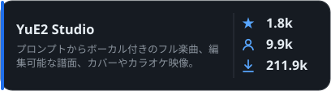</a> <a href="https://github.com/timoncool/ACE-Step-Studio">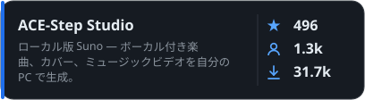</a>

<a href="https://github.com/timoncool/dub-studio">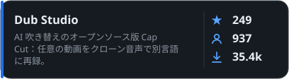</a> <a href="https://github.com/timoncool/MiniMax-Music3-Studio">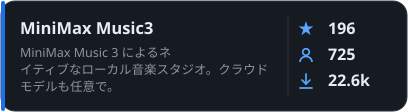</a>

<a href="https://github.com/timoncool/speech-studio">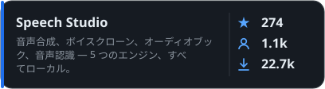</a> <a href="https://github.com/timoncool/Bulka">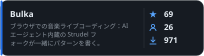</a>

<a href="https://github.com/timoncool/dungeon-ultimate">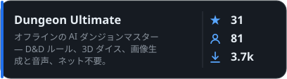</a>

### プロジェクトの作業


### そのほかのプロジェクト

####  Video & Vision

<a href="https://github.com/timoncool/videosos">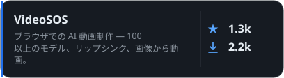</a> <a href="https://github.com/timoncool/SuperCaption_Qwen3-VL">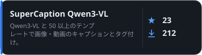</a>

####  MCP Servers

<a href="https://github.com/timoncool/telegram-api-mcp">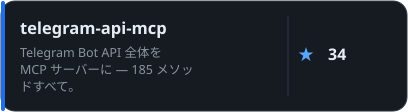</a> <a href="https://github.com/timoncool/civitai-mcp-ultimate">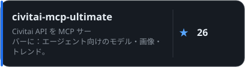</a>

<a href="https://github.com/timoncool/trail-spec">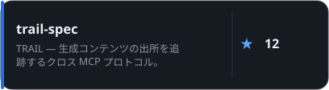</a> <a href="https://github.com/timoncool/hota-mcp">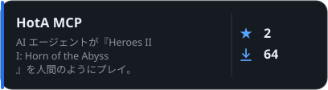</a>

####  AI Agents & Claude Code

<a href="https://github.com/timoncool/givememod">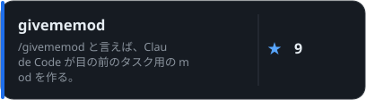</a> <a href="https://github.com/timoncool/prompt-warrior">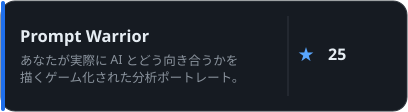</a>

<a href="https://github.com/timoncool/satori">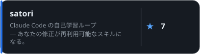</a> <a href="https://github.com/timoncool/dream-skill">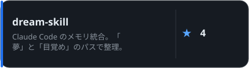</a>

<a href="https://github.com/timoncool/angry-switcher">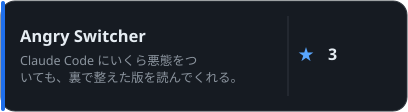</a> <a href="https://github.com/timoncool/slapbox">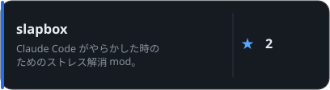</a>

<a href="https://github.com/timoncool/jarvis-codex-bot">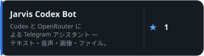</a>

####  Tools & Fun

<a href="https://github.com/timoncool/godot-strudel">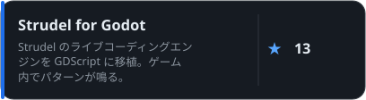</a> <a href="https://github.com/timoncool/hermes-ru-locale">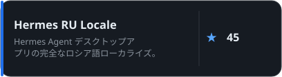</a>

<a href="https://github.com/timoncool/gitlife">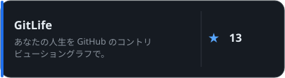</a> <a href="https://github.com/timoncool/tg-challenge-bot">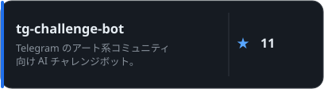</a>

<a href="https://github.com/timoncool/pip-twin">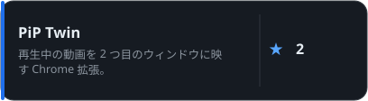</a>

### 活動を支援する

誰もが使える無料・オープンソース・ローカル優先の AI アプリを作っています。応援が制作を支えます =)

**BTC:** `1E7dHL22RpyhJGVpcvKdbyZgksSYkYeEBC` · **ETH:** `0xb5db65adf478983186d4897ba92fe2c25c594a0c` · **USDT:** `TQST9Lp2TjK6FiVkn4fwfGUee7NmkxEE7C`

更新: 2026-11-11 · 利用数は匿名の統計から毎日更新されます。

