

[English](README.md) · [Русский](README.ru.md) · [中文](README.zh.md) · [日本語](README.ja.md) · **한국어** · [Português](README.pt.md) · [Español](README.es.md) · [Français](README.fr.md)

<a href="https://timoncool.github.io/YuE2-Studio/stats.html">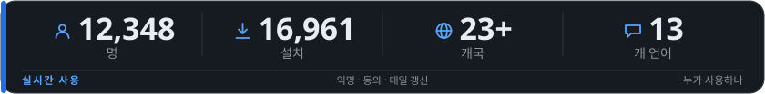</a>

**[실시간 사용 통계 보기 →](https://timoncool.github.io/YuE2-Studio/stats.html)**

### 주요 앱

<a href="https://github.com/timoncool/YuE2-Studio">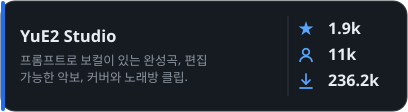</a> <a href="https://github.com/timoncool/ACE-Step-Studio">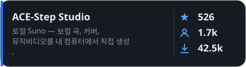</a>

<a href="https://github.com/timoncool/dub-studio">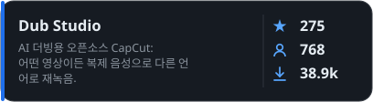</a> <a href="https://github.com/timoncool/MiniMax-Music3-Studio">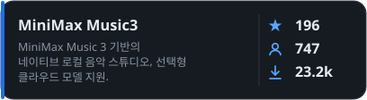</a>

<a href="https://github.com/timoncool/speech-studio">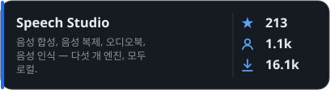</a> <a href="https://github.com/timoncool/Bulka">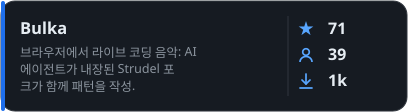</a>

<a href="https://github.com/timoncool/dungeon-ultimate">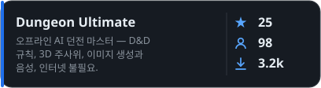</a>

### 프로젝트 작업


### 다른 프로젝트

####  Video & Vision

<a href="https://github.com/timoncool/videosos">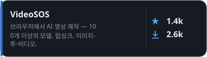</a> <a href="https://github.com/timoncool/SuperCaption_Qwen3-VL">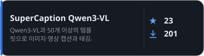</a>

####  MCP Servers

<a href="https://github.com/timoncool/telegram-api-mcp">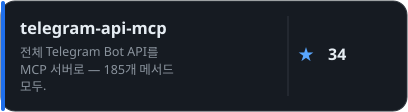</a> <a href="https://github.com/timoncool/civitai-mcp-ultimate">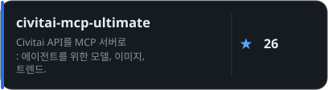</a>

<a href="https://github.com/timoncool/trail-spec">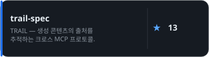</a> <a href="https://github.com/timoncool/hota-mcp">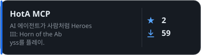</a>

####  AI Agents & Claude Code

<a href="https://github.com/timoncool/givememod">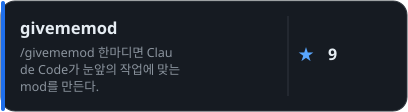</a> <a href="https://github.com/timoncool/prompt-warrior">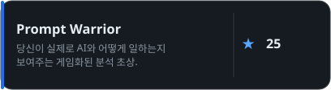</a>

<a href="https://github.com/timoncool/satori">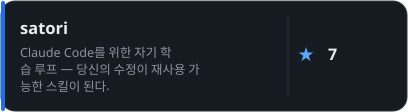</a> <a href="https://github.com/timoncool/dream-skill">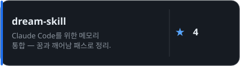</a>

<a href="https://github.com/timoncool/angry-switcher">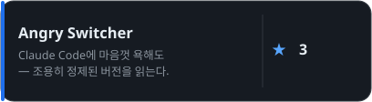</a> <a href="https://github.com/timoncool/slapbox">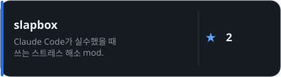</a>

<a href="https://github.com/timoncool/jarvis-codex-bot">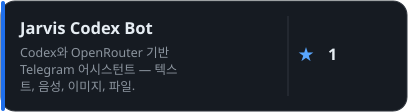</a>

####  Tools & Fun

<a href="https://github.com/timoncool/godot-strudel">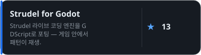</a> <a href="https://github.com/timoncool/hermes-ru-locale">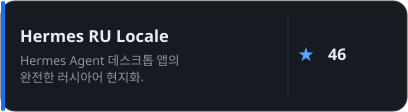</a>

<a href="https://github.com/timoncool/gitlife">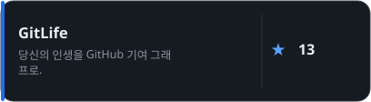</a> <a href="https://github.com/timoncool/tg-challenge-bot">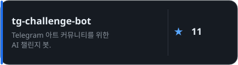</a>

<a href="https://github.com/timoncool/pip-twin">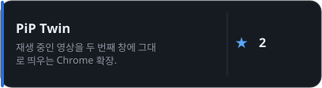</a>

### 후원하기

누구나 쓸 수 있는 무료 오픈소스 로컬 우선 AI 앱을 만듭니다. 여러분의 후원이 큰 힘이 됩니다 =)

**BTC:** `1E7dHL22RpyhJGVpcvKdbyZgksSYkYeEBC` · **ETH:** `0xb5db65adf478983186d4897ba92fe2c25c594a0c` · **USDT:** `TQST9Lp2TjK6FiVkn4fwfGUee7NmkxEE7C`

업데이트: 2026-11-13 · 사용 수치는 익명 통계에서 매일 갱신됩니다.

