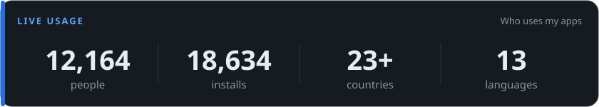
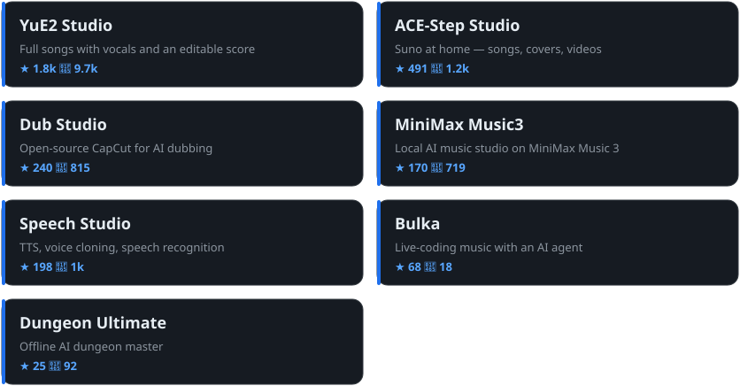

**English** · [Русский](README.ru.md) · [中文](README.zh.md) · [日本語](README.ja.md) · [한국어](README.ko.md) · [Português](README.pt.md) · [Español](README.es.md) · [Français](README.fr.md)

**[See the live, open telemetry →](https://timoncool.github.io/YuE2-Studio/stats.html)**

### Apps

### The work, this month

**231** issues closed · **1,809** commits · **204** releases · **5,162** stars

### More projects

<h4>🎬 Video &amp; Vision</h4>

| Project | Description | Stars |
|---|---|---|
| **[VideoSOS](https://github.com/timoncool/videosos)** | AI video production in the browser — 100+ models, lip sync, image-to-video |  |
| **[SuperCaption Qwen3-VL](https://github.com/timoncool/SuperCaption_Qwen3-VL)** | Image &amp; video captioning + tagging — Qwen3-VL, 50+ templates |  |

<h4>🔌 MCP Servers</h4>

| Project | Description | Stars |
|---|---|---|
| **[telegram-api-mcp](https://github.com/timoncool/telegram-api-mcp)** | Full Telegram Bot API as an MCP server — all 185 methods |  |
| **[civitai-mcp-ultimate](https://github.com/timoncool/civitai-mcp-ultimate)** | Civitai API as an MCP server — models, images, trends |  |
| **[trail-spec](https://github.com/timoncool/trail-spec)** | TRAIL — cross-MCP content tracking protocol |  |
| **[HotA MCP](https://github.com/timoncool/hota-mcp)** | An AI agent plays Heroes III: Horn of the Abyss as a real player |  |

<h4>🧠 AI Agents &amp; Claude Code</h4>

| Project | Description | Stars |
|---|---|---|
| **[givememod](https://github.com/timoncool/givememod)** | Say /givememod and Claude Code builds a mod for the task in front of you |  |
| **[Prompt Warrior](https://github.com/timoncool/prompt-warrior)** | Gamified analytical portrait of your AI workflow |  |
| **[satori](https://github.com/timoncool/satori)** | Self-learning loop for Claude Code — corrections become skills |  |
| **[dream-skill](https://github.com/timoncool/dream-skill)** | Memory consolidation for Claude Code — dream/wake passes |  |
| **[Angry Switcher](https://github.com/timoncool/angry-switcher)** | Swear at Claude Code all you like — it reads the clean version |  |
| **[slapbox](https://github.com/timoncool/slapbox)** | A stress-relief mod for Claude Code when it messes up |  |
| **[Jarvis Codex Bot](https://github.com/timoncool/jarvis-codex-bot)** | Telegram assistant on Codex + OpenRouter — text, voice, images |  |

<h4>🧰 Tools &amp; Fun</h4>

| Project | Description | Stars |
|---|---|---|
| **[Strudel for Godot](https://github.com/timoncool/godot-strudel)** | Strudel live-coding engine ported to GDScript |  |
| **[Hermes RU Locale](https://github.com/timoncool/hermes-ru-locale)** | Full Russian localization for Hermes Agent Desktop |  |
| **[GitLife](https://github.com/timoncool/gitlife)** | Your life as a GitHub contribution graph |  |
| **[tg-challenge-bot](https://github.com/timoncool/tg-challenge-bot)** | AI challenge bot for Telegram art communities |  |
| **[PiP Twin](https://github.com/timoncool/pip-twin)** | Chrome extension — the same playing video in a second window |  |

### Tech stack

<h4>Tech stack</h4>

     

   

     

Updated: 2026-11-03 · Usage numbers update daily from open, anonymous telemetry.

