

[English](README.md) · [Русский](README.ru.md) · **中文** · [日本語](README.ja.md) · [한국어](README.ko.md) · [Português](README.pt.md) · [Español](README.es.md) · [Français](README.fr.md)

**[查看实时使用统计 →](https://timoncool.github.io/YuE2-Studio/stats.html)**

### 精选应用

<a href="https://github.com/timoncool/YuE2-Studio">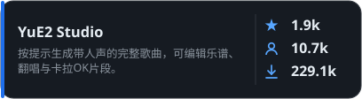</a> <a href="https://github.com/timoncool/ACE-Step-Studio">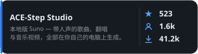</a>

<a href="https://github.com/timoncool/dub-studio">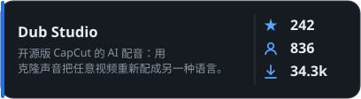</a> <a href="https://github.com/timoncool/MiniMax-Music3-Studio">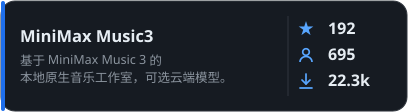</a>

<a href="https://github.com/timoncool/speech-studio">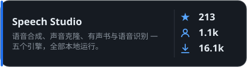</a> <a href="https://github.com/timoncool/Bulka">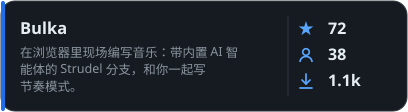</a>

<a href="https://github.com/timoncool/dungeon-ultimate">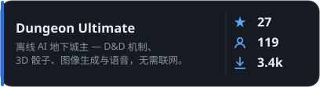</a>

### 项目工作


### 更多项目

####  Video & Vision

 <a href="https://github.com/timoncool/SuperCaption_Qwen3-VL">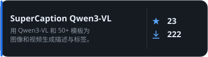</a>

####  MCP Servers

<a href="https://github.com/timoncool/telegram-api-mcp">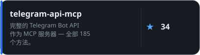</a> <a href="https://github.com/timoncool/civitai-mcp-ultimate">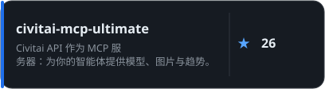</a>

<a href="https://github.com/timoncool/trail-spec">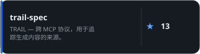</a> <a href="https://github.com/timoncool/hota-mcp">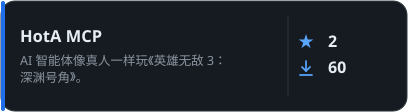</a>

####  AI Agents & Claude Code

<a href="https://github.com/timoncool/givememod">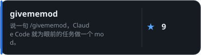</a> <a href="https://github.com/timoncool/prompt-warrior">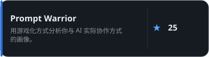</a>

<a href="https://github.com/timoncool/satori">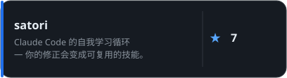</a> <a href="https://github.com/timoncool/dream-skill">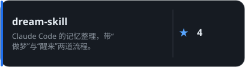</a>

<a href="https://github.com/timoncool/angry-switcher">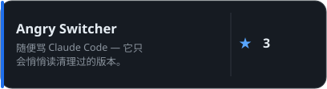</a> <a href="https://github.com/timoncool/slapbox">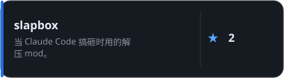</a>

<a href="https://github.com/timoncool/jarvis-codex-bot">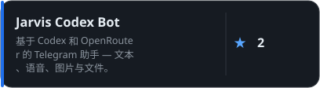</a>

####  Tools & Fun

<a href="https://github.com/timoncool/godot-strudel">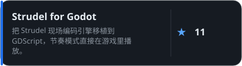</a> <a href="https://github.com/timoncool/hermes-ru-locale">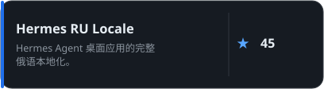</a>

<a href="https://github.com/timoncool/gitlife">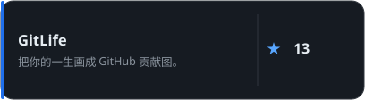</a> <a href="https://github.com/timoncool/tg-challenge-bot">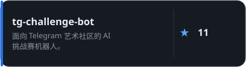</a>

<a href="https://github.com/timoncool/pip-twin">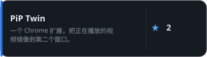</a>

### 支持我的工作

我为所有人打造免费、开源、本地优先的 AI 应用。你的支持让它们不断更新 =)

**BTC:** `1E7dHL22RpyhJGVpcvKdbyZgksSYkYeEBC` · **ETH:** `0xb5db65adf478983186d4897ba92fe2c25c594a0c` · **USDT:** `TQST9Lp2TjK6FiVkn4fwfGUee7NmkxEE7C`

更新于: 2026-11-12 · 使用数据每天从匿名统计更新。

